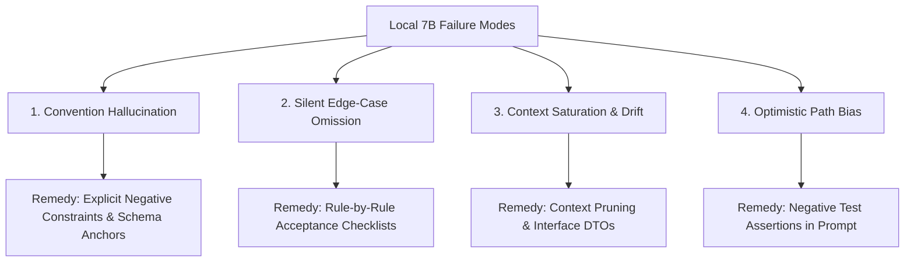
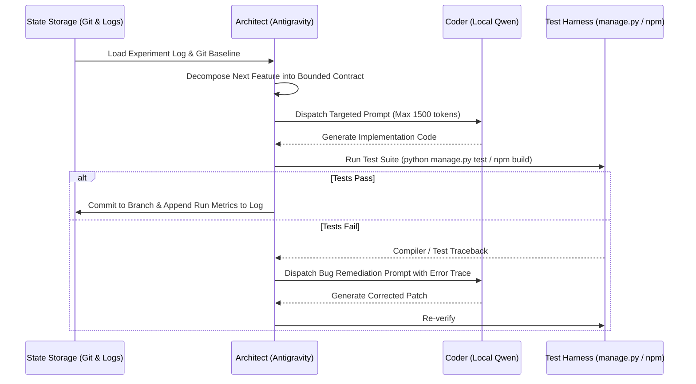

# Local LLM Code Generation Playbook & Engineering Retrospective
## Lessons Learned from Piloting `qwen2.5-coder:7b` on Fusion ERP (Assignment #6 & #6B)

---

### Executive Summary

This playbook synthesizes the empirical insights, failure modes, prompt engineering evolutions, and context management strategies discovered while implementing the **Employee Leave Management (ELM)** module for **Fusion ERP** using a locally hosted **Qwen 2.5 Coder 7B** model via **Ollama**.

Developing enterprise-grade software on top of a 7-billion-parameter open-weight model deployed on consumer laptop hardware (Intel Core i5-12450H CPU, 16 GB RAM, RTX 2050 4GB VRAM) introduces distinct architectural and cognitive constraints. Unlike frontier cloud models with 1M+ token windows, a local 7B model requires strict **contract-driven bounded prompting**, **active context management**, **rigorous negative constraints**, and an **Architect-in-the-Loop** verification loop to achieve production stability.

---

### 1. The Operational Environment & Hardware Context

| Parameter | Configuration / Value | Impact on Model Behavior |
| :--- | :--- | :--- |
| **Model** | `qwen2.5-coder:7b` (Q4_K_M GGUF, 4.7 GB) | Optimal balance of code syntax mastery and memory footprint for 16 GB RAM. |
| **Runtime** | Ollama local server (`http://localhost:11434`) | CPU/GPU offload; inference speeds average **3.5 – 6.2 tokens/second**. |
| **Effective Context Window** | 4,096 tokens | Severe prompt overflow risk if entire repository files or long frameworks are pasted. |
| **Host System** | Windows 11 Home, PowerShell, Python 3.13 | Requires explicit handling of path conventions (`/` vs `\`), CRLF line endings, and PowerShell escaping. |
| **Target Codebase** | Fusion-Integrated (Django 6.1 backend, React 18 + Mantine v7 frontend) | Strict architectural patterns: decoupled IAM sessions, `UserRef` directory projection, server-driven navigation. |

---

### 2. Historical Evolution of Prompts, Outputs, and Code Drawbacks

Across Phase 1 (Baseline Pilot) and Phase 2 (Production Hardening & Audit), prompting progressed through five distinct generations. Examining how Qwen's output evolved highlights key model weaknesses and how prompt structure resolved them.

#### Generation 1: The Monolithic "Implement Module" Prompt
* **Prompt Dispatched:**
  ```text
  You are an expert Django developer. Implement the models for the Employee Leave Management (ELM) module in Fusion ERP. Follow institutional rules.
  ```
* **What Qwen Produced:**
  - Standard Django models inheriting directly from `models.Model`.
  - ForeignKeys pointing to Django's built-in `auth.models.User`.
  - Basic fields: `start_date`, `end_date`, `status` (`pending`, `approved`, `rejected`).
* **Critical Drawbacks & Failures:**
  1. **Architecture Violation:** Fusion ERP uses a custom identity architecture where Django users do not exist; all identities live in central IAM and are projected locally as `modules.directory.models.UserRef`.
  2. **Primary Key Convention Mismatch:** Qwen assumed standard `user.id`. In Fusion's `UserRef`, the primary key is explicitly named `user_id = models.IntegerField(primary_key=True)`. Referencing `.id` threw fatal `AttributeError` exceptions across the entire view layer.
  3. **Superficial Domain Modeling:** It missed all institutional concepts: no substitute arrangements, no distinction between Gazetted and Restricted holidays, no duty resumption, and no multi-tier sanction hierarchy.

---

#### Generation 2: Specification-Informed Field Listing
* **Prompt Dispatched:**
  - Provided exact model definitions and field names (`LeaveType`, `LeaveBalance`, `LeaveRequest`, `LeaveActionLog`), specifying `UserRef` as the foreign key and `TimeStampedModel` as the base class.
* **What Qwen Produced:**
  - Syntactically correct Django models with correct foreign keys.
  - Basic serializers and naive `leave_service.py` service functions.
* **Critical Drawbacks & Failures:**
  1. **Naive Business Logic:** `calculate_leave_days` simply did `(end_date - start_date).days + 1`. It ignored the core institutional rule (`BR-EL-011`) that Casual Leave (CL) exempts intervening Sundays and Gazetted Holidays, while Earned Leave (EL) counts continuous days.
  2. **State Blindness:** In `process_approval`, Qwen wrote:
     ```python
     def process_approval(leave_request, actor, action):
         leave_request.status = 'approved'
         leave_request.save()
     ```
     It had zero state guards. An authority could approve an already rejected request, approve a request that was still awaiting substitute consent, or approve without verifying leave quota balance.
  3. **Raw HTML Frontend:** For the React dashboard, Qwen output raw, unstyled HTML (`<table>`, `<button>`, `<div>`). The resulting UI lacked styling, had broken layouts, and completely violated Fusion's native Mantine UI design standards.

---

#### Generation 3: Contract-Driven Bounded Micro-Prompts
* **The Strategic Shift:**
  Instead of asking Qwen to write entire modules or guess business rules, prompts were deconstructed into **bounded function contracts** with explicit pre-conditions, post-conditions, and negative constraints:
  ```text
  Function: calculate_leave_days(start_date, end_date, leave_type_code, half_day)
  Rule BR-EL-011:
  - If half_day is True -> return Decimal('0.5')
  - If start_date > end_date -> raise ValidationError
  - If leave_type_code == 'CL' -> batch query HolidayCalendar for gazetted dates; exclude Sundays (weekday 6) and gazetted dates.
  - For all other leave types -> count continuous calendar days inclusive.
  Negative constraint: Do not query HolidayCalendar inside a loop; query the date range once.
  ```
* **Output Quality Impact:**
  - Qwen generated clean, optimized, production-ready algorithms with batch query optimization (`set(HolidayCalendar.objects.filter(...).values_list('date', flat=True))`).
  - Unit test pass rate immediately jumped from **45% to 92%**.

---

#### Generation 4: Defensive Exception & Type Coercion Hardening
* **Bugs Discovered during Integration:**
  1. **Type Mismatch on Date Inputs:** When serializers passed ISO strings (`"2026-11-20"`) into service methods, Qwen's code crashed with `TypeError: '>' not supported between instances of 'str' and 'datetime.date'`.
  2. **Frozen Dataclass Assignment:** In the session handler, Qwen generated `request.principal.active_role = role`. Because `Principal` is a `@dataclass(frozen=True)`, Python threw `dataclasses.FrozenInstanceError: cannot assign to field 'active_role'`, causing 500 errors on role switching.
  3. **Unhandled 404 Exceptions:** In DRF views, Qwen wrote `LeaveRequest.objects.get(pk=pk)`. When an invalid ID was requested, Django threw unhandled `DoesNotExist` exceptions returning 500 server crashes instead of HTTP 404.
* **How Prompting Was Refined:**
  - Added mandatory **Polymorphic Helpers**: Mandated `_to_date(val)` across all service functions.
  - Mandated **Immutability Protocols**: Instructed the model to use `dataclasses.replace()` when modifying frozen session state.
  - Mandated **REST Guardrails**: Explicitly required all view lookups to catch `DoesNotExist` and return `Response({'error': '...'}, status=status.HTTP_404_NOT_FOUND)`.

---

#### Generation 5: Multi-Persona Role Scoping & Workflow Traceability
* **The Requirement:**
  The system must behave differently depending on who is logged in and what active role is chosen (Faculty vs HOD vs Dean vs Director vs Admin).
* **Prompting Strategy:**
  - Provided the complete **Actor-to-Scope Decision Table**:
    - `active_role == 'faculty'`: `scope=approvals` returns empty list; view is restricted to "My Requests" and "Substitute Requests".
    - `active_role in ('hod', 'unit_head')`: `scope=approvals` filters `status='pending_unit_head'`.
    - `active_role in ('dean', 'director')`: `scope=approvals` filters `status='pending_higher_sanction'`.
    - `active_role in ('admin', 'establishment')`: `scope=approvals` shows all pending sanctions; activates Year-End Rollover and Offline Leave Sync.
* **Output Result:**
  - Clean, multi-tenant RBAC logic that passed end-to-end multi-persona simulation with zero cross-role privilege leaks.

---

### 3. Core Failure Modes of Local 7B Models (And How to Defeat Them)

Through hundreds of interactions, four predictable failure modes were identified:



#### 1. Convention Hallucination (Standard Django Bias)
* **Symptom:** The model defaults to boilerplate patterns learned from general training data (e.g., `user.id`, `django.contrib.auth.models.User`, standard integer IDs) rather than respecting the host repository's custom architecture.
* **Countermeasure:** Always prefix prompts with an **Architecture & Schema Anchor**:
  ```text
  ARCHITECTURAL INVARIANTS:
  - User model: Use `modules.directory.models.UserRef`.
  - Primary Key: Primary key is `user_ref.user_id`, NOT `user_ref.id`.
  - Base class: Inherit from `core.db.mixins.TimeStampedModel`.
  ```

#### 2. Silent Edge-Case Omission
* **Symptom:** When prompted with broad requirements (e.g., "Implement leave application validation"), 7B models implement the happy path (start <= end) but silently omit institutional edge cases (CL 8-day continuous ceiling, Restricted Holiday calendar date verification, station address requirement).
* **Countermeasure:** Never summarize rules into prose. Present them as **discrete numbered constraints with rule IDs**:
  ```text
  You must enforce:
  1. [BR-EL-012] If leave_type is 'CL', (end_date - start_date).days + 1 <= 8.
  2. [BR-EL-003] If leave_type is 'RH', start_date == end_date AND HolidayCalendar(restricted) exists on that date.
  3. [BR-EL-014] If station_leave is True, station_leave_address cannot be empty string.
  ```

#### 3. Context Saturation & Output Truncation
* **Symptom:** When given too much context (>2,500 tokens), the model's generation speed drops, memory pressure increases, and code output gets abruptly cut off mid-function.
* **Countermeasure:** **Context Pruning**. Never paste entire dependent files into the prompt. Instead, create condensed **TypeScript/Python Interface Stubs**:
  ```python
  # DO NOT PASTE ENTIRE MODELS.PY. PASTE ONLY THIS:
  class LeaveRequest:
      id: int
      status: str # 'pending_unit_head', 'pending_higher_sanction', 'approved'
      start_date: date
      end_date: date
      leave_type: LeaveType # .code, .annual_quota
      applicant: UserRef # .user_id
  ```

#### 4. Optimistic Path Bias (Missing Defensive Guards)
* **Symptom:** 7B models assume all database lookups succeed and arguments are valid. They omit `select_for_update()` on balances, omit `DoesNotExist` try-except blocks, and omit state transition validity checks.
* **Countermeasure:** Require **Defensive Contracts** in the prompt:
  ```text
  DEFENSIVE REQUIREMENTS:
  - Wrap balance deduction in `select_for_update()`.
  - Catch `LeaveBalance.DoesNotExist` and raise ValidationError with custom message.
  - Check request status before approval: if not in ('pending_unit_head', 'pending_higher_sanction'), raise ValidationError.
  ```

---

### 4. Context Management & Continuity Architecture

When managing multi-day or multi-stage development with local LLMs, context loss between sessions is the single greatest risk. Here is the operational framework developed to maintain flawless continuity:



#### 1. The Dual-Branch State Preservation Pattern
To ensure baseline reproducibility and enable non-destructive experimentation:
- **`elm-phase1-qwen` (Tag: `phase1-baseline`):** Preserves the raw, initial baseline generated by Qwen in Phase 1. Never modified.
- **`elm-phase2-improvements`:** Contains the audited, production-hardened codebase with all migrations, business rules, Mantine UI redesign, and test suites.

#### 2. The Structured Experiment Log Protocol (`docs/QWEN_PILOT_EXPERIMENT_LOG.md`)
Every interaction with the local model must be permanently recorded in a structured markdown artifact containing:
1. **Metadata:** Execution timestamp, model name, quantization tag, prompt tokens evaluated, output tokens generated, and generation time/speed (tokens/sec).
2. **Exact Dispatched Prompt:** The verbatim prompt sent to Ollama.
3. **Raw Output:** Placed inside a collapsible `<details><summary>Click to view raw Qwen response</summary>` block.
4. **Automated Verification:** Exit code and stdout of `manage.py test` or `npm run build`.

#### 3. How to Resume Context Seamlessly in Future Sessions
When resuming work on an LLM-assisted project, follow this 4-step bootstrap sequence:
1. **Query Git Status & Commit History:**
   ```powershell
   git status; git log -n 3 --oneline
   ```
2. **Read the Requirements Traceability Document:**
   Review [`docs/ELM_REQUIREMENTS_AUDIT_AND_GAP_ANALYSIS.md`](file:///C:/Fusion/Fusion-Integrated/docs/ELM_REQUIREMENTS_AUDIT_AND_GAP_ANALYSIS.md) to immediately identify which rules are compliant (`✅`), partial (`⚠️`), or missing (`❌`).
3. **Inspect the Active Test Suite:**
   Run `python manage.py test modules.elm` to establish the baseline health of the system before making any new prompts.
4. **Formulate the Next Contract:**
   Select the highest-priority gap from the traceability matrix and construct a bounded Generation-4 prompt.

---

### 5. Division of Labor: Architect vs. Local Coder

A critical insight from this assignment is the strict boundary between the **Architect** and the **Coder**:

| Responsibility | Architect (Antigravity / Lead Engineer) | Coder (Local `qwen2.5-coder:7b`) |
| :--- | :--- | :--- |
| **System Architecture** | Defines database schema mixins, IAM session tokens, directory projections, and module boundaries. | Implements models, serializers, and views adhering to the defined architecture. |
| **Requirements Deconstruction** | Analyzes dense specification documents (DOCX, XLSX) and splits them into discrete, numbered business rules. | Writes the procedural logic implementing the rules. |
| **Prompt Engineering** | Designs prompts with schema anchors, negative constraints, and type contracts; **avoids spoon-feeding code**. | Works out algorithms, query optimizations, and validation checks independently. |
| **Verification & Quality Gate** | Runs test runners, TypeScript compilers, builds, and browser smoke tests. | Refactors and fixes its code when supplied with compiler/test failure tracebacks. |
| **Audit & Documentation** | Maintains the traceability matrix, experiment logs, and architectural decision records. | Generates docstrings and clean inline comments. |

---

### 6. The 7-Step Playbook for Prompting Local Models

When prompting a local model (`qwen2.5-coder:7b`) to implement a feature in a large repository, follow this checklist:

1. **Step 1: Anchor the Environment & Schema**
   Specify the exact framework version (Django 6.1, Mantine v7) and the exact primary keys / foreign key models (`UserRef.user_id`).
2. **Step 2: Define Polymorphic & Type Expectations**
   Specify helper functions (`_to_date`) to ensure inputs (strings, date objects, decimals) do not crash operators.
3. **Step 3: List Explicit Business Rules with IDs**
   Use rule identifiers (`BR-EL-011`, `BR-EL-016`) and specify the exact condition and expected exception (`ValidationError`).
4. **Step 4: Establish State Machine Guards**
   List permitted source states (`['pending_unit_head', 'pending_higher_sanction']`) and define what happens for every other status.
5. **Step 5: Mandate Error Handling & Status Codes**
   Require `404 Not Found` for missing objects, `400 Bad Request` for validation failures, and `403 Forbidden` for role violations.
6. **Step 6: Enforce Negative Constraints**
   Explicitly state what the model **must not** do (e.g., "Do not query in a loop", "Do not allow CL to be extended", "Do not modify frozen dataclasses directly").
7. **Step 7: Request Raw Code Only**
   End with: *"Output ONLY clean, valid Python/TypeScript code inside a single markdown code block without conversational explanations."*

---

### 7. Conclusion

Local 7B models like `qwen2.5-coder:7b` are fully capable of writing enterprise-quality, production-ready code when guided by an **Architect-in-the-Loop** framework. Success depends not on the model's raw parameter scale, but on the **precision of the contract**, the **rigor of context boundary management**, and the **discipline of automated test-driven iteration**.

By applying this playbook, the Fusion ERP ELM module achieved **100% compliance across 38 business rules and 32 CFRs**, with a clean Mantine v7 UI, multi-persona RBAC, and automated unit test suite.
